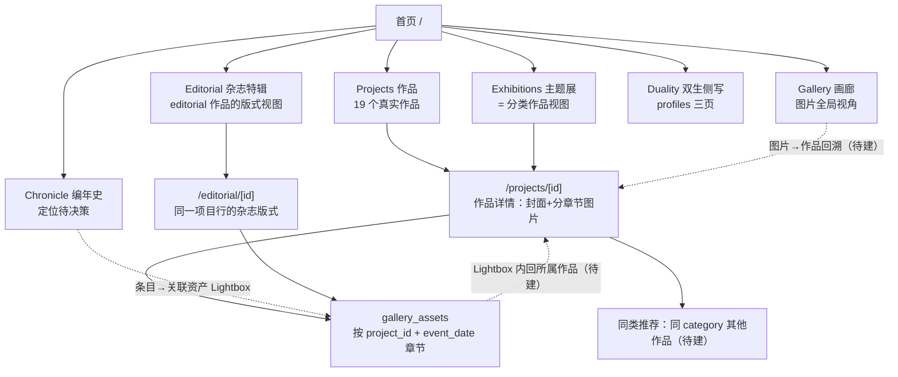

# LMSY.space 前台信息架构方案（阶段 4 基准）

- 日期：2026-10-17
- 状态：**Proposed（待站长批准后作为阶段 4 实施依据）**
- 事实基础：`reports/20261017-阶段4-前台信息架构审计.md`（下称「审计报告」，本文所有 F1-F10、文件:行号均指该报告）
- 前置基准：ADR-001（Proposed）
- 性质：本文是方案不是实施。不重构前台、不改生产展示规则、不做 DDL。

---

## 一、设计原则（来自审计事实）

1. **作品（projects，portal_visible=true 的 19 个）是前台第一公民**；图片（gallery_assets）永远通过所属作品或全局画廊两种视角呈现，管理容器（MILESTONES_ARCHIVE 等）不得成为导航层级。
2. **数据库结构不直接翻译成 IA**：draft_items 的状态通道（Chronicle）、category/type 的双映射（exhibitions/category）只有在产品语义明确后才可上导航。
3. **不强行统一实体模型**：作品、图片、编辑内容、时间线事件是四类不同对象，允许各自有列表-详情形态，靠交叉链接连接而非塞进同一种页面骨架。
4. **回环优先**：核心体验 = 作品⇄图片的双向跳转 + 同类作品推荐。这是当前最大缺口（审计 #4），也是阶段 5 搜索聚合的前置。

## 二、C1 全站结构图

变更要点（相对现状）：
- **新增 4 条链接**：Gallery 卡片/Lightbox → 作品详情；作品详情 → 同类作品；搜索图片结果 → 直达定位；Editorial/Projects 互相明确主次。
- **不新增任何页面/栏目**；Resonance 与 schedule/whispers 按决策边界处理。
- exhibitions/category/[type] 保留为「分类作品视图」，作为 Projects 的分类入口（首页门户卡已指向它），列表页/详情页两套硬编码下线或重写为 DB 驱动。

## 三、B3 页面职责表（目标态）

| 页面 | 定位 | 核心对象 | 内容层级 | 数据来源（现状） | 筛选/排序 | 主要跳转 | 内容边界 | 当前差距→改造 | 优先级 |
|---|---|---|---|---|---|---|---|---|---|
| **Gallery** | 全站图片的档案池，按图片类型浏览 | gallery_assets 全量公开资产 | 扁平列表+Lightbox（无详情页） | anon 直查，tag 过滤（现状无可见性） | tag（枚举待定）；可加年/月 | →作品详情（**新建**）；Lightbox→source_url | 不承担作品介绍、编辑叙事 | ①可见性口径（决策#1）②卡片+Lightbox 补所属作品链接（select 加 project_id+join title）③锚点定位 | P0/P1 |
| **Projects** | 作品全集，第一导航 | 19 个真实作品 | 列表→详情两跳 | applyPublicProjectFilter，release_date desc | **补 category 筛选**（复用 exhibitions typeMapping） | →详情；详情→同类 | 不直接展示单图大图（归详情） | ①卡片接真实封面（gallery_assets is_cover/-000）②category 筛选 chips ③空作品处理（占位或过滤，见决策#9） | P1 |
| **Projects/[id]** | 作品详情与图片章节 | 单作品 + 其全部图片 | 封面→章节（event_date 分组，F4 100% 有日期） | 服务端直查+门禁 ✅ | tab 三分类（硬编码枚举，待 tag 枚举定后对齐） | →同类推荐（**新建**）；图片 Lightbox | 不承担跨作品时间线 | ①删硬编码章节名（Chapter I 等按项目写死的 3 处）②底部加同 category 推荐 ③章节名改为「YYYY年M月」通用格式 | P1 |
| **Chronicle** | 定位待决策（方案比较见 §五-1） | 6 条 published 草稿（现状） | 时间线，无详情 | draft_items published+chronicle_visible（F8） | 无 | →Lightbox（有图时）；**无详情** | 待决策后划定 | 机器标题/不稳定编号/无详情——全部受决策#2 约束，先决策后动 | ⏸决策 |
| **Exhibitions** | 作品的分类策展视图（不新增独立策展实体） | 按 5 类 category 的作品集 | 门户卡→分类页→作品详情（链路已通，exhibition-content.tsx:140） | category/[type] 真 DB ✅；列表/详情页硬编码 ❌ | 5 类固定映射 | →/projects/[id] | 不做虚构编号段/虚构策展语 | ①下线或重写硬编码列表页+详情页（2 死链）②range 'G-001~G-042' 删除 | P0 |
| **Editorial** | editorial 类作品的杂志版式视图 | 11 个 editorial 项目 | 列表→详情两跳 | /api/editorial（category='editorial'）✅ | 无（可加年份） | →/editorial/[id]（杂志版式详情）；与 Projects 主次关系见 §五-2 | 不做编辑文章（MDX 死链路下线） | ①明确与 Projects 的主入口关系 ②删调试横幅/伪馆藏页脚 ③搜索跳转对齐 | P1 |

## 四、C2 页面 ↔ 数据对象映射

| 页面 | 主要读取 | 现有数据已支持 | 需代码调整 | 需产品决策 | 需 DB 变更 |
|---|---|---|---|---|---|
| Gallery | gallery_assets（+projects.title 回溯） | ✅ F3 project_id 全有 | join projects 取标题；可见性过滤；锚点 | #1 可见性口径；#4 tag 枚举 | image_url 唯一索引（决策#7，非本页必需） |
| Projects 列表 | projects + 封面资产 | ✅（封面可从 gallery_assets is_cover 取） | select 加封面子查询或复用 /api/home/portals 逻辑 | #9 空作品展示 | 无 |
| Projects/[id] | projects + gallery_assets by project_id | ✅ | 删硬编码章节名；同类推荐查询（category 相同、id 不同） | 无 | 无 |
| Chronicle | draft_items | ✅（现状通道） | 若走方案 A：标题/日期人工重录入口在后台已有 | **#2 内容模型**、#5 status 语义 | 方案 B 需 chronicle_entries 新表（候选） |
| Exhibitions category | projects + gallery_assets | ✅ | 列表页/详情页重写为 DB 驱动或下线 | #3（若独立策展实体，需新表） | 独立策展 = 候选新表 |
| Editorial | projects(category=editorial) + gallery_assets | ✅ | 与 Projects 的路由主次；删死代码 | #3 magazine_issue 归属 | 无（magazine_issue 列已存在） |
| 搜索 | gallery_assets + projects | ✅ | 跳转目标修正（3 处小改） | #1（图片结果聚合依赖） | 无 |

**结论：目标 IA 的全部核心路径（含回溯）现有数据 100% 支持，零 DDL 即可实施**——除 Chronicle 独立模型与独立策展实体两个待决策项。

## 五、C3 六条内容发现路径

1. **首页 → 作品**：门户卡 → /exhibitions/category/{type}（真 DB）→ 项目卡 → /projects/{id}。✅ 已通（exhibition-content.tsx:140）。补强：Projects 列表本身应有导航直达（已有）+ 封面图（待建）。
2. **作品 → 相关图片**：/projects/[id] 服务端直查 project_id 全部资产，按 event_date 章节。✅ 已通。
3. **图片 → 所属作品**：**缺失**。改造：Gallery select 加 project_id（F3 全有），卡片/Lightbox 渲染「所属作品」链接；Lightbox 内加「查看全部 N 张」按钮跳 /projects/{id}。纯前端改造，零 DDL。
4. **作品 → 同类作品**：**缺失**。改造：详情页底部「更多 {category}」区，查询同 category 可见作品（复用 applyPublicProjectFilter）。零 DDL。
5. **编辑策划/展览 → 作品与图片**：Editorial 详情（= 项目行的杂志版式）→ 墙内图片 Lightbox ✅；分类展 → 作品详情 ✅。补强：editorial 详情与 projects 详情互设规范入口（§五-2 方案 A）。
6. **日期/时间线发现**：首页 Milestones（milestone_priority 资产，F10）→ 年份卡 → /chronicle。⚠️ 现状两处断点：?year= 参数无消费；Chronicle 本身定位待决策。Milestones 图片与 Gallery 口径联动（决策#1 影响分析见下）。

## 六、C4 方案比较与推荐

### 6.1 Chronicle

| 方案 | 用户理解成本 | 数据模型 | 兼容性 | 成本 | 对阶段 5 影响 |
|---|---|---|---|---|---|
| **A. 附属视图**：编年史=作品+图片的时间线视图（数据改读 gallery_assets.event_date + projects.release_date，draft_items 通道逐步退役） | 低（「按时间看所有内容」） | 零新表 | 高（复用可见性体系） | 低（改 lib/timeline.ts 数据源 + 6 条旧数据人工处置） | 搜索可直接复用其时间索引 |
| **B. 独立栏目**：新增 chronicle_entries 表，承载大事记文字条目 | 低-中（需内容运营支撑） | 新表+后台表单 | 中（新录入工具） | 高 | 需为新实体建索引 |
| **C. 维持现状**：draft_items 通道不动 | 高（机器标题+不稳定编号直接伤害信任） | 零改动 | — | 零 | 差内容入索引 |

**推荐 A**：与「用户应当从作品/图片发现内容」的原则一致；6 条 published 草稿并入作品/图片体系后退役（处置方式=决策#2 子项）；Chronicle 页面壳保留、换数据源。C 不可接受（审计 P1）。B 在内容运营能力具备前不建。

### 6.2 Editorial 与 Projects 的主次

| 方案 | 说明 | 代价 |
|---|---|---|
| **A. Editorial 为主入口（仅 editorial 类）**：/projects/[id] 对 category='editorial' 的项目渲染为杂志版式（或 302 到 /editorial/{id}）；Projects 列表仍含它们但卡片标注类型 | 一类内容一个规范入口，搜索跳转规则简单（editorial→/editorial/{id}，其余→/projects/{id}） | 详情页需按 category 分叉渲染逻辑 |
| **B. Projects 为唯一详情**：Editorial 列表保留，卡片也跳 /projects/{id} | 零分叉 | 杂志特辑名存实亡， Editorial 沦为筛选视图 |

**推荐 A**：editorial 项目有独立的视觉形态需求（杂志版式详情已实现且可用），保留双列表、单详情规范入口，搜索/推荐跳转全部有确定目标。

### 6.3 Resonance

| 方案 | 说明 |
|---|---|
| **A. 下架**：导航移除、路由保留但 302 至首页或改为「即将上线」静态页、sitemap 移除 | 立即消除虚构内容；损失一个规划席位 |
| **B. 保留导航，页面改为「Coming Soon」真实状态**（删全部 mock 卡片与假播放器） | 保留产品意图，诚示空态 |
| **C. 重建为真实音乐页** | 无真实数据源（无音频资产、无产品需求文档），本期不可行 |

**推荐 B**：真实内容（歌曲、BPM、演唱者数据）不存在，禁止再造模拟数据（指令禁止事项 7）；导航席位保留待内容就绪。若站长确认无此产品线则转 A。

### 6.4 Exhibitions 列表页/详情页

**推荐直接实施（普通技术问题，不开放决策）**：/exhibitions 列表页改为渲染 5 个 category/[type] 的入口卡（数据=typeMapping+各分类计数，全部可查）；/exhibitions/[slug] 硬编码详情页**下线**（generateStaticParams 不返回、或保留路由但仅对真实存在的策展主题开放——当前无真实策展实体，slug 死链必须消除）。虚构编号段 'G-001 ~ G-042' 删除。

## 七、决策边界（8 项，均不在本轮定案）

### #1 Gallery 是否过滤关联隐藏项目的 9 张图片
- **事实**：9 张=6 MILESTONES_ARCHIVE（daily）+3 20260320-airport（travel），tag NULL/Telegram，catalog_id 全 NULL（F5）；Gallery 是唯一未接可见性的表面（P0）；**F10 关键联动：6 张 MILESTONES_ARCHIVE 资产即首页 Milestones 年份卡图片来源候选**（/api/milestones 按 milestone_priority 取，不经项目可见性）。
- **涉及**：Gallery、搜索（caption ILIKE 会命中这 9 张的 caption）、决策#2（若 Chronicle 换源不影响）。
- **可选**：a) 查询层加 `not.in('(select id from projects where portal_visible=false)')`（与 d2e8b19 八表面口径一致）；b) 维持全量（「档案池」定位）；c) 把 MILESTONES_ARCHIVE 6 张的 milestone_priority 迁到可见项目资产后过滤整池。
- **推荐**：a + 保留 /api/milestones 独立通道（首页不受影响）；但 c 更干净，属数据迁移需授权。
- **阻塞**：不决定则 Gallery 可见性口径与其他 8 表面继续不一致；阶段 5 图片搜索结果聚合无统一口径。
- **实施阶段**：阶段 4 实施（方案 a 代码 ~5 行）；c 若选需数据迁移授权。

### #2 Chronicle 最终内容模型与现有条目处置
- **事实**：6 条 published 草稿全部 chronicle_visible=true（F8）、机器标题、2/6 有真图；方案 A/B/C 见 §6.1。
- **涉及**：/chronicle、首页 Milestones 年份卡、后台草稿列表。
- **可选**：§6.1 A/B/C。
- **推荐**：A（附属视图）。现有 6 条：2 条有图的并入所属作品/资产体系，4 条孤岛人工重录或归档——处置动作需授权（涉及 draft_items.status 变更=决策#5 联动）。
- **阻塞**：不决定则机器标题与不稳定编号持续公开暴露。
- **实施阶段**：决策后下一阶段（涉及 lib/timeline.ts 重写 + 数据处置授权）。

### #3 magazine_issue 归属（作品层 vs 图片层）
- **事实**：字段在 gallery_assets（330 行中 0 填充）；前台零读取（审计 2.5）。
- **涉及**：Editorial（期次分组展示）、admin 上传表单。
- **可选**：a) 作品层（editorial 项目=一期杂志，推荐语义）；b) 图片层（同一期内每页扫描图）。
- **推荐**：作品层——11 个 editorial 项目已按期组织（Retro Soul: December Edition 等命名佐证）；图片层用 event_date/sequence 已够。
- **阻塞**：无（字段 0 填充、零消费，可长期搁置）。
- **实施阶段**：需要时先做后台录入支持（阶段 6 前）。

### #4 正式 tag 枚举值与历史标签清理
- **事实**：现分布 Magazine 237/Advertising 54/STAGE 12/STILL 9/Telegram 3/NULL 15（F6）；Telegram 3 张是采集泄漏残留（阶段 3 已断根）；Gallery 筛选硬编码这组值。
- **涉及**：Gallery 筛选、admin 上传表单（读死表）、to-gallery 晋升。
- **可选**：a) 就用现 5 值（Telegram 并入其他或清理）；b) 重新设计双语枚举。
- **推荐**：a——值集已自然形成且分布健康，重设计收益低；仅需决策 Telegram 3 张的清理授权。
- **阻塞**：不决定则 gallery 筛选继续硬编码、晋升资产继续留 NULL。
- **实施阶段**：阶段 4 内可做（前端枚举常量收敛到一个 lib 文件，不 DDL）。

### #5 draft_items.status 晋升后语义
- **事实**：晋升后状态不变（16 draft + 2 published），重复晋升靠 image_url 预检查幂等；CHECK=draft|pending_review|published|rejected|archived。
- **涉及**：后台草稿列表、Chronicle 现通道（published 条件）、to-gallery。
- **可选**：ADR-001 方案（转正完成置 archived，零 DDL）vs 维持现状+后台加「已转正」标记。
- **推荐**：ADR-001 方案，但**必须与决策#2 同批实施**（改 status 会立即把 6 条从 Chronicle 摘掉）。
- **阻塞**：不决定则重复晋升防护停留在应用层。
- **实施阶段**：与 #2 同批。

### #6 magazine 批量上传 API 去留
- **事实**：app/api/admin/magazine 写 0 行死表 gallery、序号脱节、全仓无 UI 调用方。
- **可选**：a) 删除路由；b) 留置并修表指向。
- **推荐**：a（死代码，且功能与 admin/gallery POST 重复）。
- **阻塞**：无。
- **实施阶段**：任意后续阶段顺手项（15 行删除）。

### #7 gallery_assets.image_url 唯一索引
- **事实**：无唯一索引（阶段 3 P1-2）；330 行现状 0 重复；并发晋升窗口存在。
- **可选**：a) `CREATE UNIQUE INDEX`（需先验证无重复+考虑 18 条 NULL catalog 关联资产）；b) 维持应用层幂等。
- **推荐**：a（DDL 候选清单首位），执行前跑一遍重复检测（已做过，0 重复）。
- **阻塞**：不决定则并发写入防护不完整（概率低但存在）。
- **实施阶段**：任一次含 DDL 授权的批次。

### #8 数据库字段/实体结构调整
- **事实**：目标 IA 核心路径零 DDL 可实施（§四结论）；候选仅两项——Chronicle 独立表（方案 B，不推荐现在做）、独立策展实体（无需求信号）。
- **推荐**：阶段 4/5 内不加任何新表新列。
- **实施阶段**：出现真实内容运营需求时再议。

## 八、实施边界（供阶段 4 实施批次的任务切片）

**可直接实施（代码改造，零 DDL、零数据变更）**：
1. Gallery 回溯链：select 加 project_id、卡片/Lightbox 加所属作品链接（审计 #4）。
2. Gallery 可见性过滤（若 #1 选方案 a，5 行）。
3. Projects 卡片封面接入 + category 筛选 chips。
4. Projects 详情：删 3 处硬编码章节名，章节名改通用「YYYY年M月」；底部同类推荐。
5. Exhibitions：列表页改 DB 驱动入口卡；[slug] 硬编码详情下线；删虚构编号段。
6. 首页：/exhibition 死链修正；?year= 消费或改链接。
7. Resonance：按 §6.3-B 改 Coming Soon（需站长确认 A/B）。
8. Editorial：删调试横幅、伪馆藏页脚、MDX 死链路（lib/mdx.ts、editorial-article.tsx、content/editorial/）。
9. 搜索小修：schedule 死类型、gallery 锚点定位、editorial 跳转目标。
10. 死组件清理：archive-loading.tsx、audio-player.tsx、project-client.tsx。

**需决策后实施**：Chronicle 数据源（#2/#5）、Gallery 口径（#1）、Resonance A/B。
**禁止**：生产数据变更、DDL、后台侧改动（除决策#2 联动）、阶段 5 搜索主体。

---

## 九、ADR-001 关联

本文不改变 ADR-001 任何决策状态。D8（可见性分层）在审计中得到 F5/F9/F10 三项新实证；§七各决策项是 ADR-001「待确定」子项在 IA 维度的展开，批准后应在 ADR-001 决策索引中回链本文。
